# BundleCreator: court and tribunal journey maps

**BundleCreator. Hearing Readiness.** These maps show the usual stages of a case in England and Wales, one map for each of 25 areas of law, with links to the official rules and forms for each.

> [!IMPORTANT]
> This page is general information, not legal advice. BundleCreator is a bundle-preparation tool. It is not a law firm. The law, court fees and time limits change, so check the official source for your own case and seek legal advice.

The pictures on this page are still images. The maps are interactive only on [bundlecreator.co](https://bundlecreator.co): select any map to open the live version, where each stop explains the step and the documents it needs.

## For every area

- [Court bundle rules, by court and tribunal](https://bundlecreator.co/court-bundle-rules)
- [Guides and videos](https://bundlecreator.co/guides)
- [Glossary of court bundle terms](https://bundlecreator.co/glossary)
- [Courts and tribunals directory](https://bundlecreator.co/courts)
- GOV.UK: [Represent yourself in court](https://www.gov.uk/represent-yourself-in-court) · [Find a court or tribunal](https://www.gov.uk/find-court-tribunal) · [Court and tribunal forms](https://www.gov.uk/government/collections/court-and-tribunal-forms) · [Check if you can get legal aid](https://www.gov.uk/check-legal-aid)
- Independent help: [Citizens Advice](https://www.citizensadvice.org.uk/) · [Advicenow](https://www.advicenow.org.uk/) · [Support Through Court](https://www.supportthroughcourt.org/) · [Law Centres Network](https://www.lawcentres.org.uk/) · [Advocate](https://weareadvocate.org.uk/)

## Areas of law

- **Family:** [Child Arrangements](#child-arrangements) · [Divorce (Financial Remedy)](#divorce-financial-remedy) · [Domestic Abuse (FL401)](#domestic-abuse-fl401) · [Public Children Law (Care Proceedings)](#public-children-law-care-proceedings) · [ToLATA (Trusts of Land)](#tolata-trusts-of-land)
- **Civil, housing and property:** [Small Claims](#small-claims) · [Civil / County Court](#civil--county-court) · [Company & Commercial Litigation](#company--commercial-litigation) · [Personal Injury](#personal-injury) · [Medical Negligence](#medical-negligence) · [Housing Disrepair](#housing-disrepair) · [Housing Possession & Tenant Debt](#housing-possession--tenant-debt) · [Tenancy Variation & Rent Review](#tenancy-variation--rent-review) · [Conveyancing](#conveyancing) · [Commercial Property](#commercial-property)
- **Tribunals:** [Employment Tribunal](#employment-tribunal) · [Immigration & Asylum Tribunal](#immigration--asylum-tribunal) · [SEND Tribunal (England)](#send-tribunal-england) · [Property Chamber (FTT)](#property-chamber-ftt) · [Money & Tax](#money--tax)
- **Crime, probate, insolvency and specialist:** [Criminal Law](#criminal-law) · [Wills, Trust & Probate](#wills-trust--probate) · [Intellectual Property](#intellectual-property) · [Bankruptcy](#bankruptcy) · [Regulatory Law](#regulatory-law)

---

## Family

### Child Arrangements

[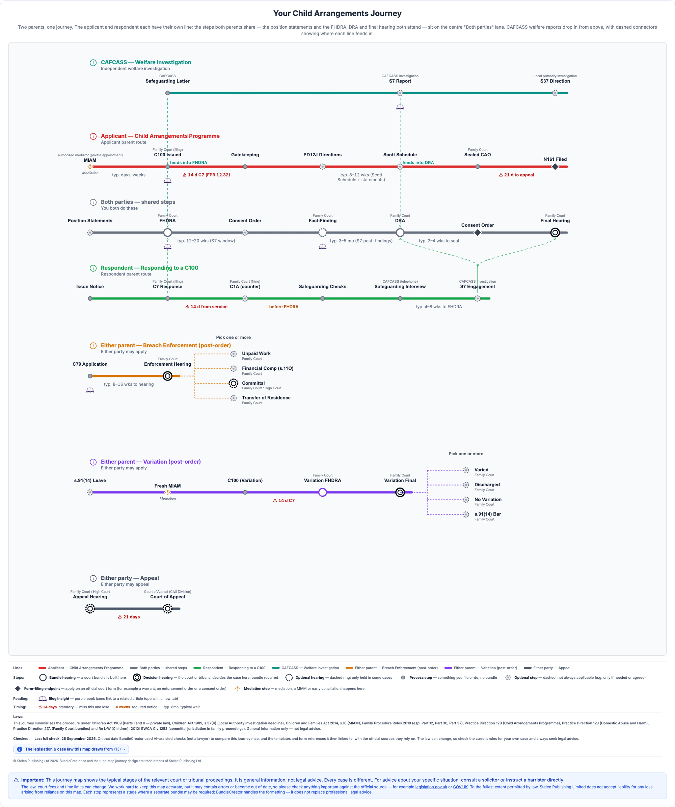](https://bundlecreator.co/cao#journey-map)

- **Interactive map and guide:** [bundlecreator.co/cao](https://bundlecreator.co/cao)
- **Rules and legislation:** [Family Procedure Rules and practice directions](https://www.justice.gov.uk/courts/procedure-rules/family/rules_pd_menu) · [Practice Direction 12B (Child Arrangements Programme)](https://www.justice.gov.uk/courts/procedure-rules/family/practice_directions/pd_part_12b) · [Practice Direction 27A (court bundles)](https://www.justice.gov.uk/courts/procedure-rules/family/practice_directions/pd_part_27a) · [Children Act 1989](https://www.legislation.gov.uk/ukpga/1989/41/contents)
- **Official starting points:** [Making child arrangements if you divorce or separate](https://www.gov.uk/looking-after-children-divorce) · [Form C100](https://www.gov.uk/government/publications/form-c100-application-under-the-children-act-1989-for-a-child-arrangements-prohibited-steps-specific-issue-section-8-order-or-to-vary-or-discharge)
- **Court welfare service (advises the court about the child):** [Cafcass (England)](https://www.cafcass.gov.uk/) · [Cafcass Cymru (Wales)](https://www.gov.wales/cafcass-cymru)

### Divorce (Financial Remedy)

[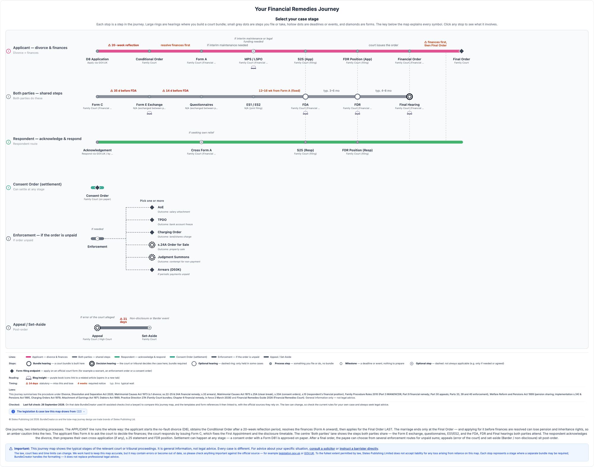](https://bundlecreator.co/divorce#journey-map)

- **Interactive map and guide:** [bundlecreator.co/divorce](https://bundlecreator.co/divorce)
- **Rules and legislation:** [Family Procedure Rules, Part 9 (applications for a financial remedy)](https://www.justice.gov.uk/courts/procedure-rules/family/parts/part_09) · [Practice Direction 27A (court bundles)](https://www.justice.gov.uk/courts/procedure-rules/family/practice_directions/pd_part_27a) · [Matrimonial Causes Act 1973](https://www.legislation.gov.uk/ukpga/1973/18/contents)
- **Official starting points:** [Money and property when you divorce or separate](https://www.gov.uk/money-property-when-relationship-ends)

### Domestic Abuse (FL401)

[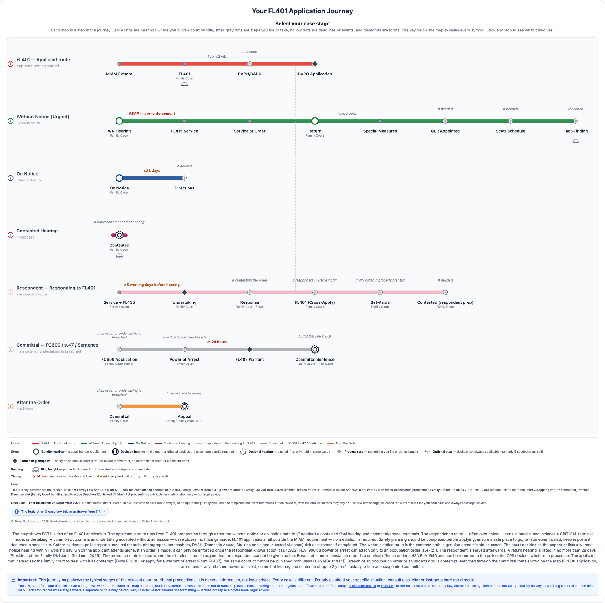](https://bundlecreator.co/domestic-abuse#journey-map)

- **Interactive map and guide:** [bundlecreator.co/domestic-abuse](https://bundlecreator.co/domestic-abuse)
- **Rules and legislation:** [Family Procedure Rules, Part 10 (applications under Part 4 of the Family Law Act 1996)](https://www.justice.gov.uk/courts/procedure-rules/family/parts/part_10) · [Family Law Act 1996](https://www.legislation.gov.uk/ukpga/1996/27/contents) · [Practice Direction 27A (court bundles)](https://www.justice.gov.uk/courts/procedure-rules/family/practice_directions/pd_part_27a)
- **Official starting points:** [Get an injunction if you've been the victim of domestic abuse](https://www.gov.uk/injunction-domestic-violence)
- **Independent help:** [National Domestic Abuse Helpline](https://www.nationaldahelpline.org.uk/) · [Rights of Women](https://www.rightsofwomen.org.uk/)

### Public Children Law (Care Proceedings)

[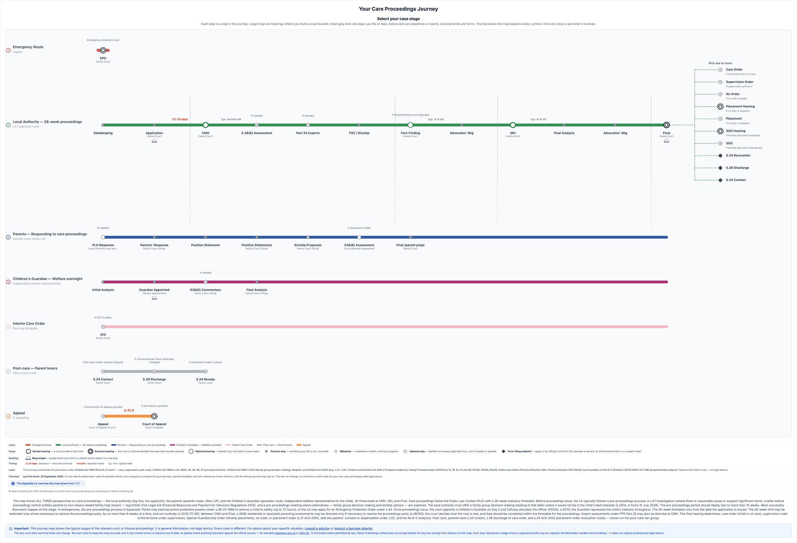](https://bundlecreator.co/public-children-law#journey-map)

- **Interactive map and guide:** [bundlecreator.co/public-children-law](https://bundlecreator.co/public-children-law)
- **Rules and legislation:** [Practice Direction 12A (care, supervision and other Part 4 proceedings)](https://www.justice.gov.uk/courts/procedure-rules/family/practice_directions/pd_part_12a) · [Practice Direction 27A (court bundles)](https://www.justice.gov.uk/courts/procedure-rules/family/practice_directions/pd_part_27a) · [Children Act 1989](https://www.legislation.gov.uk/ukpga/1989/41/contents)
- **Official starting points:** [If your child is taken into care](https://www.gov.uk/if-your-child-is-taken-into-care)
- **Court welfare service (advises the court about the child):** [Cafcass (England)](https://www.cafcass.gov.uk/) · [Cafcass Cymru (Wales)](https://www.gov.wales/cafcass-cymru)

### ToLATA (Trusts of Land)

[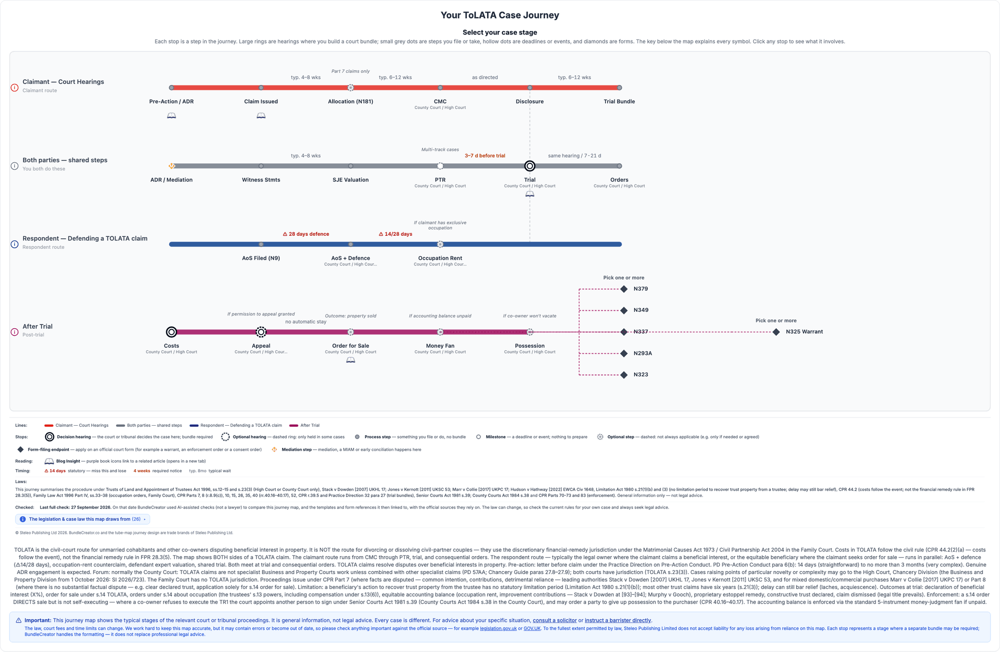](https://bundlecreator.co/tolata#journey-map)

- **Interactive map and guide:** [bundlecreator.co/tolata](https://bundlecreator.co/tolata)
- **Rules and legislation:** [Trusts of Land and Appointment of Trustees Act 1996](https://www.legislation.gov.uk/ukpga/1996/47/contents) · [Civil Procedure Rules and practice directions](https://www.justice.gov.uk/courts/procedure-rules/civil/rules) · [Part 7 (how to start proceedings)](https://www.justice.gov.uk/courts/procedure-rules/civil/rules/part07) · [Part 8 (alternative procedure: for claims unlikely to involve a substantial dispute of fact)](https://www.justice.gov.uk/courts/procedure-rules/civil/rules/part08)
- A ToLATA claim is a civil claim, brought under the Civil Procedure Rules.
- **Official starting points:** [Court and tribunal forms](https://www.gov.uk/government/collections/court-and-tribunal-forms)

---

## Civil, housing and property

### Small Claims

[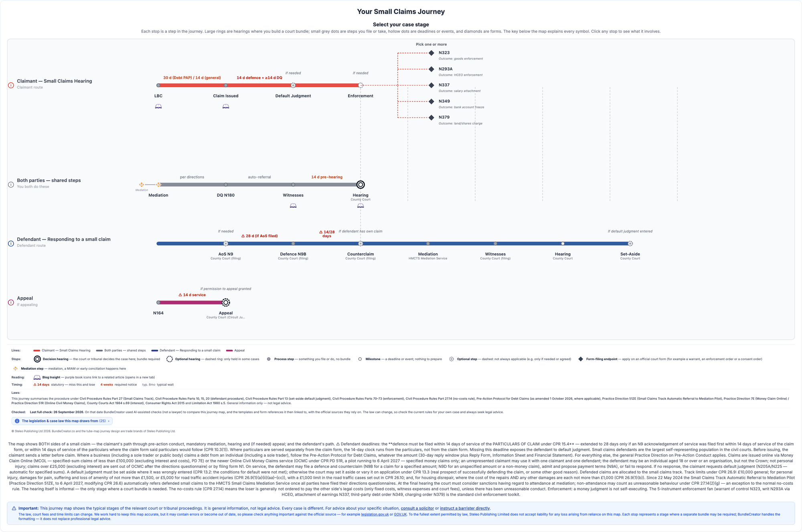](https://bundlecreator.co/small-claims#journey-map)

- **Interactive map and guide:** [bundlecreator.co/small-claims](https://bundlecreator.co/small-claims)
- **Rules and legislation:** [Civil Procedure Rules, Part 27 (the small claims track)](https://www.justice.gov.uk/courts/procedure-rules/civil/rules/part27)
- **Official starting points:** [Make a court claim for money](https://www.gov.uk/make-court-claim-for-money)

### Civil / County Court

[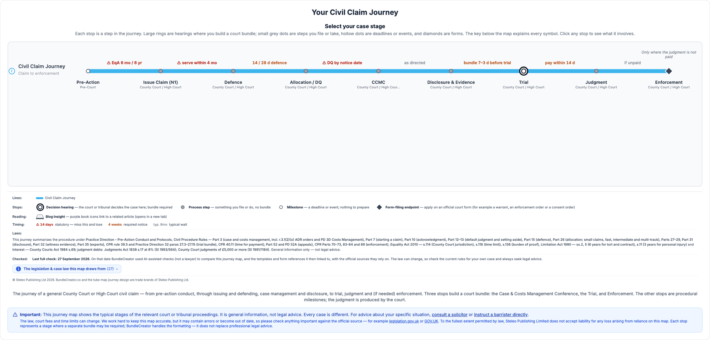](https://bundlecreator.co/civil-litigation#journey-map)

- **Interactive map and guide:** [bundlecreator.co/civil-litigation](https://bundlecreator.co/civil-litigation)
- **Rules and legislation:** [Civil Procedure Rules and practice directions](https://www.justice.gov.uk/courts/procedure-rules/civil/rules) · [Practice Direction: Pre-Action Conduct and Protocols](https://www.justice.gov.uk/courts/procedure-rules/civil/rules/pd_pre-action_conduct) · [Practice Direction 32 (evidence)](https://www.justice.gov.uk/courts/procedure-rules/civil/rules/part32/pd_part32) · [Civil Procedure Rules, Part 39 (rule 39.5: trial bundles)](https://www.justice.gov.uk/courts/procedure-rules/civil/rules/part39)
- **Official starting points:** [Form N1 (claim form)](https://www.gov.uk/government/publications/form-n1-claim-form-cpr-part-7)

### Company & Commercial Litigation

[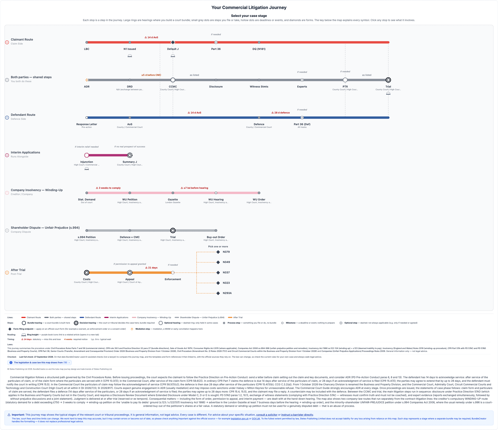](https://bundlecreator.co/commercial-litigation#journey-map)

- **Interactive map and guide:** [bundlecreator.co/commercial-litigation](https://bundlecreator.co/commercial-litigation)
- **Rules and legislation:** [Civil Procedure Rules and practice directions](https://www.justice.gov.uk/courts/procedure-rules/civil/rules)
- **Official starting points:** [Business and Property Courts (judiciary.uk)](https://www.judiciary.uk/courts-and-tribunals/business-and-property-courts/)

### Personal Injury

[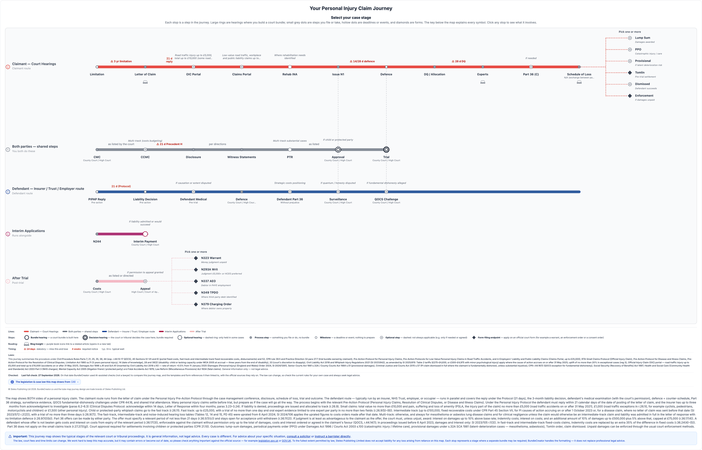](https://bundlecreator.co/personal-injury#journey-map)

- **Interactive map and guide:** [bundlecreator.co/personal-injury](https://bundlecreator.co/personal-injury)
- **Rules and legislation:** [Pre-Action Protocol for Personal Injury Claims](https://www.justice.gov.uk/courts/procedure-rules/civil/protocol/prot_pic) · [Pre-Action Protocol for Personal Injury Claims below the Small Claims Limit in Road Traffic Accidents (the RTA Small Claims Protocol)](https://www.justice.gov.uk/courts/procedure-rules/civil/protocol/pre-action-protocol-for-personal-injury-claims-below-the-small-claims-limit-in-road-traffic-accidents-the-rta-small-claims-protocol) · [Civil Procedure Rules and practice directions](https://www.justice.gov.uk/courts/procedure-rules/civil/rules)
- **Official starting points:** [Court and tribunal forms](https://www.gov.uk/government/collections/court-and-tribunal-forms)

### Medical Negligence

[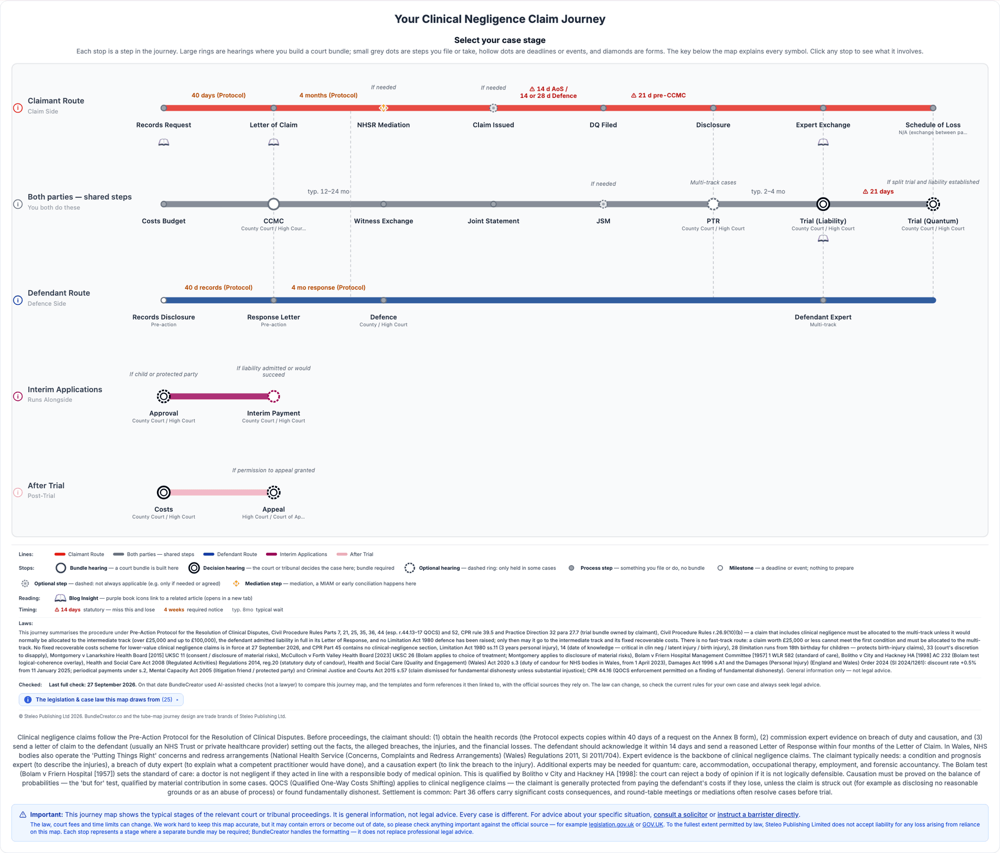](https://bundlecreator.co/medical-negligence#journey-map)

- **Interactive map and guide:** [bundlecreator.co/medical-negligence](https://bundlecreator.co/medical-negligence)
- **Rules and legislation:** [Pre-Action Protocol for the Resolution of Clinical Disputes](https://www.justice.gov.uk/courts/procedure-rules/civil/protocol/prot_rcd) · [Civil Procedure Rules and practice directions](https://www.justice.gov.uk/courts/procedure-rules/civil/rules)
- **Official starting points:** [Court and tribunal forms](https://www.gov.uk/government/collections/court-and-tribunal-forms)
- **Independent help:** [Action against Medical Accidents (AvMA)](https://www.avma.org.uk/)

### Housing Disrepair

[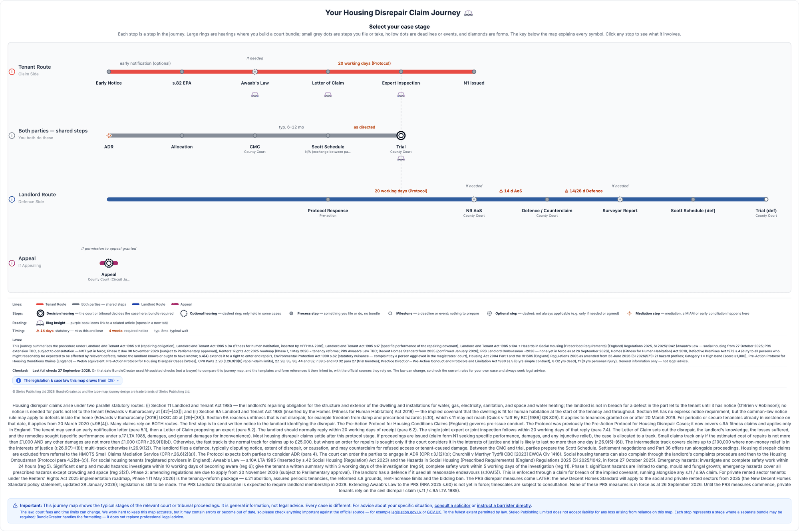](https://bundlecreator.co/housing-disrepair#journey-map)

- **Interactive map and guide:** [bundlecreator.co/housing-disrepair](https://bundlecreator.co/housing-disrepair)
- **Rules and legislation:** [Pre-Action Protocol for Housing Conditions Claims (England)](https://www.justice.gov.uk/courts/procedure-rules/civil/protocol/prot_hou) · [Pre-Action Protocol for Housing Disrepair Cases (Wales)](https://www.justice.gov.uk/courts/procedure-rules/civil/protocol/pre-action-protocol-for-housing-disrepair-cases-wales) · [Landlord and Tenant Act 1985](https://www.legislation.gov.uk/ukpga/1985/70/contents)
- **Official starting points:** [Court and tribunal forms](https://www.gov.uk/government/collections/court-and-tribunal-forms)
- **Independent help:** [Shelter England](https://england.shelter.org.uk/)

### Housing Possession & Tenant Debt

[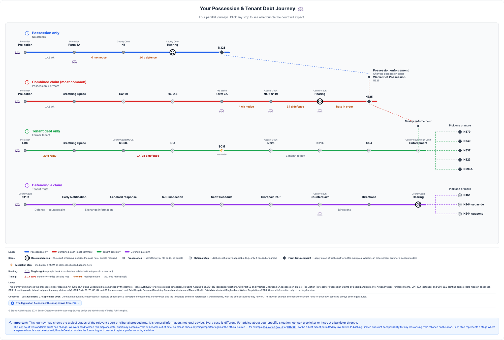](https://bundlecreator.co/housing-possession-debt#journey-map)

- **Interactive map and guide:** [bundlecreator.co/housing-possession-debt](https://bundlecreator.co/housing-possession-debt)
- **Rules and legislation:** [Civil Procedure Rules, Part 55 (possession claims)](https://www.justice.gov.uk/courts/procedure-rules/civil/rules/part55) · [Pre-Action Protocol for Possession Claims by Social Landlords](https://www.justice.gov.uk/courts/procedure-rules/civil/protocol/pre-action-protocol-for-possession-claims-by-social-landlords) · [Housing Act 1988 (notices and grounds for possession, as amended by the Renters' Rights Act 2025)](https://www.legislation.gov.uk/ukpga/1988/50/contents)
- **Wales:** most tenancies and licences of a home are occupation contracts under the [Renting Homes (Wales) Act 2016](https://www.legislation.gov.uk/anaw/2016/1/contents); the GOV.UK pages and the Shelter England link are for England.
- **Official starting points:** [Evicting tenants in England (landlords)](https://www.gov.uk/evicting-tenants) · [Private renting: evictions in England (tenants)](https://www.gov.uk/private-renting-evictions)
- **Independent help:** [Shelter England](https://england.shelter.org.uk/) · [National Debtline](https://nationaldebtline.org/)

### Tenancy Variation & Rent Review

[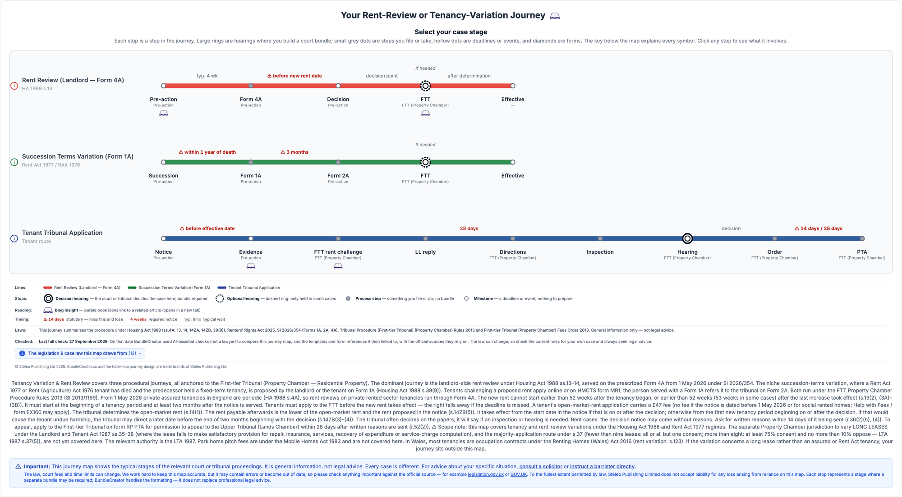](https://bundlecreator.co/tenancy-variation#journey-map)

- **Interactive map and guide:** [bundlecreator.co/tenancy-variation](https://bundlecreator.co/tenancy-variation)
- **Rules and legislation:** [Housing Act 1988](https://www.legislation.gov.uk/ukpga/1988/50/contents) · [Tribunal Procedure (First-tier Tribunal) (Property Chamber) Rules 2013](https://www.legislation.gov.uk/uksi/2013/1169/contents)
- **England only.** In Wales, see the [Renting Homes (Wales) Act 2016](https://www.legislation.gov.uk/anaw/2016/1/contents).
- **Official starting points:** [Solve a residential property dispute](https://www.gov.uk/housing-tribunals)
- **Independent help:** [Shelter England](https://england.shelter.org.uk/)

### Conveyancing

[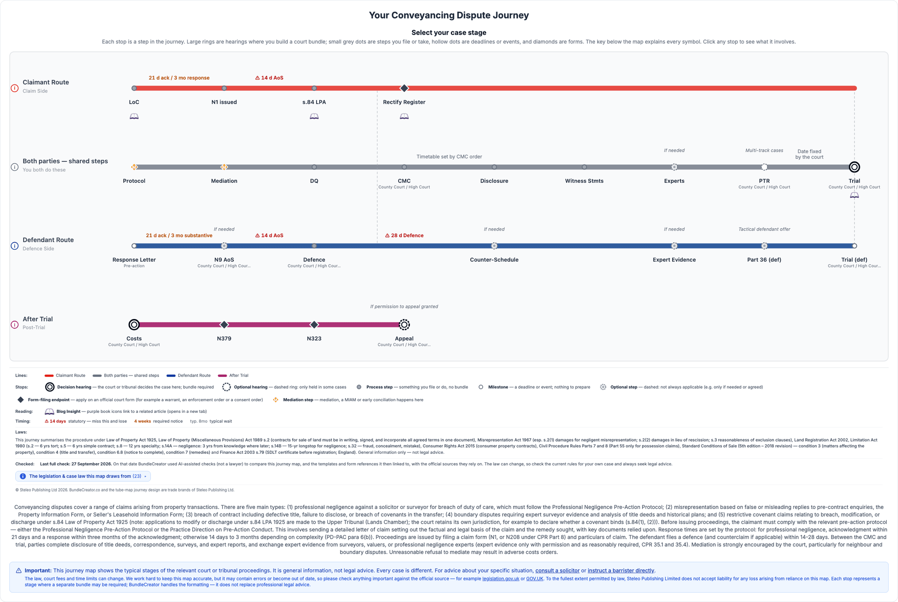](https://bundlecreator.co/conveyancing#journey-map)

- **Interactive map and guide:** [bundlecreator.co/conveyancing](https://bundlecreator.co/conveyancing)
- **Rules and legislation:** [Land Registration Act 2002](https://www.legislation.gov.uk/ukpga/2002/9/contents) · [Tribunal Procedure (First-tier Tribunal) (Property Chamber) Rules 2013](https://www.legislation.gov.uk/uksi/2013/1169/contents) · [Civil Procedure Rules and practice directions](https://www.justice.gov.uk/courts/procedure-rules/civil/rules)
- **Official starting points:** [HM Land Registry](https://www.gov.uk/government/organisations/land-registry) · [First-tier Tribunal (Property Chamber)](https://www.gov.uk/courts-tribunals/first-tier-tribunal-property-chamber)

### Commercial Property

[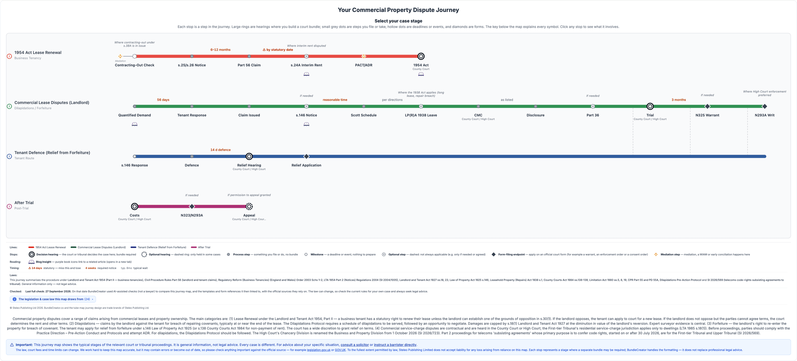](https://bundlecreator.co/commercial-property#journey-map)

- **Interactive map and guide:** [bundlecreator.co/commercial-property](https://bundlecreator.co/commercial-property)
- **Rules and legislation:** [Landlord and Tenant Act 1954](https://www.legislation.gov.uk/ukpga/Eliz2/2-3/56/contents) · [Civil Procedure Rules, Part 56 (landlord and tenant claims)](https://www.justice.gov.uk/courts/procedure-rules/civil/rules/part56)
- **Official starting points:** [Court and tribunal forms](https://www.gov.uk/government/collections/court-and-tribunal-forms)

---

## Tribunals

### Employment Tribunal

[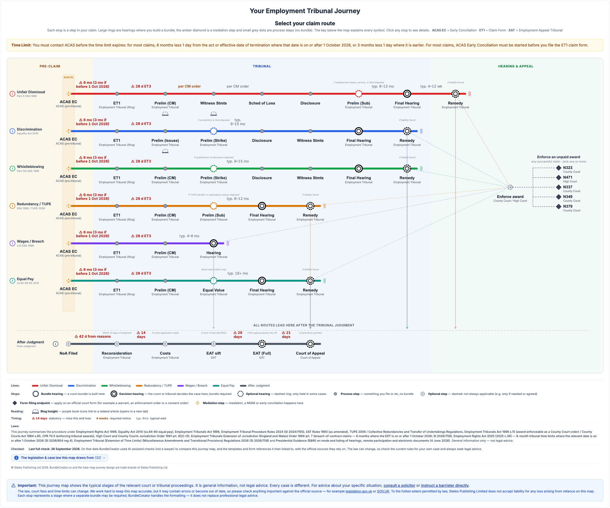](https://bundlecreator.co/employment#journey-map)

- **Interactive map and guide:** [bundlecreator.co/employment](https://bundlecreator.co/employment)
- **Rules and legislation:** [Employment Tribunal Procedure Rules 2024](https://www.legislation.gov.uk/uksi/2024/1155/contents)
- **Official starting points:** [Make a claim to an employment tribunal](https://www.gov.uk/employment-tribunals) · [Employment Tribunal](https://www.gov.uk/courts-tribunals/employment-tribunal)
- **Independent help:** [Acas](https://www.acas.org.uk/)

### Immigration & Asylum Tribunal

[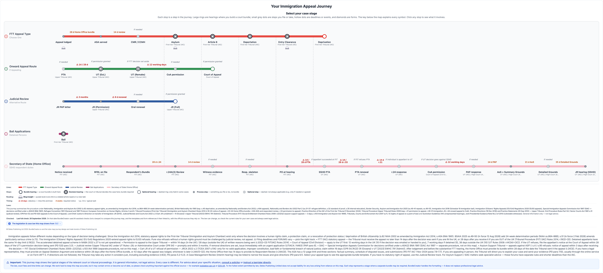](https://bundlecreator.co/immigration#journey-map)

- **Interactive map and guide:** [bundlecreator.co/immigration](https://bundlecreator.co/immigration)
- **Rules and legislation:** [Tribunal Procedure (First-tier Tribunal) (Immigration and Asylum Chamber) Rules 2014](https://www.legislation.gov.uk/uksi/2014/2604/contents)
- **Official starting points:** [Appeal against a visa or immigration decision](https://www.gov.uk/immigration-asylum-tribunal) · [First-tier Tribunal (Immigration and Asylum)](https://www.gov.uk/courts-tribunals/first-tier-tribunal-immigration-and-asylum)

### SEND Tribunal (England)

[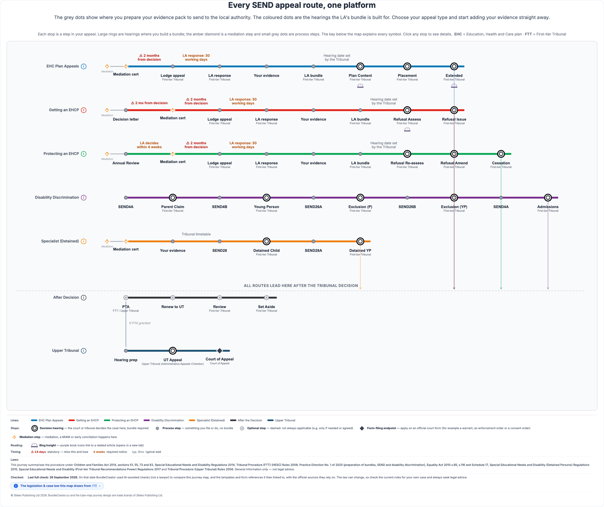](https://bundlecreator.co/send#journey-map)

- **Interactive map and guide:** [bundlecreator.co/send](https://bundlecreator.co/send)
- **Rules and legislation:** [Tribunal Procedure (First-tier Tribunal) (Health, Education and Social Care Chamber) Rules 2008](https://www.legislation.gov.uk/uksi/2008/2699/contents)
- In Wales, appeals go to the [Education Tribunal for Wales](https://educationtribunal.gov.wales/).
- **Official starting points:** [First-tier Tribunal (Special Educational Needs and Disability)](https://www.gov.uk/courts-tribunals/first-tier-tribunal-special-educational-needs-and-disability)
- **Independent help:** [IPSEA](https://www.ipsea.org.uk/)

### Property Chamber (FTT)

[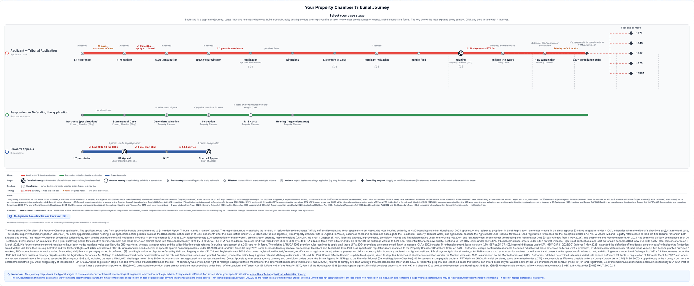](https://bundlecreator.co/property-chamber#journey-map)

- **Interactive map and guide:** [bundlecreator.co/property-chamber](https://bundlecreator.co/property-chamber)
- **Rules and legislation:** [Tribunal Procedure (First-tier Tribunal) (Property Chamber) Rules 2013](https://www.legislation.gov.uk/uksi/2013/1169/contents)
- **Official starting points:** [First-tier Tribunal (Property Chamber)](https://www.gov.uk/courts-tribunals/first-tier-tribunal-property-chamber) · [Solve a residential property dispute](https://www.gov.uk/housing-tribunals) (residential property cases: England only; Wales has different ways to apply)

### Money & Tax

[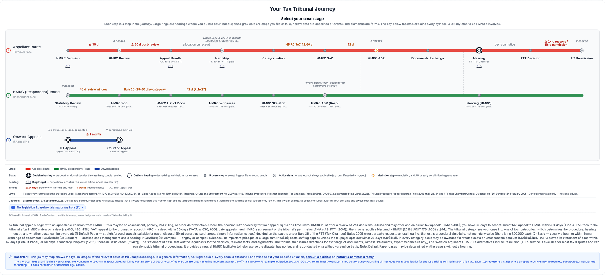](https://bundlecreator.co/money-tax#journey-map)

- **Interactive map and guide:** [bundlecreator.co/money-tax](https://bundlecreator.co/money-tax)
- **Rules and legislation:** [Tribunal Procedure (First-tier Tribunal) (Tax Chamber) Rules 2009](https://www.legislation.gov.uk/uksi/2009/273/contents)
- **Official starting points:** [Appeal to the tax tribunal](https://www.gov.uk/tax-tribunal) · [First-tier Tribunal (Tax)](https://www.gov.uk/courts-tribunals/first-tier-tribunal-tax)
- **Independent help:** [TaxAid](https://taxaid.org.uk/)

---

## Crime, probate, insolvency and specialist

### Criminal Law

[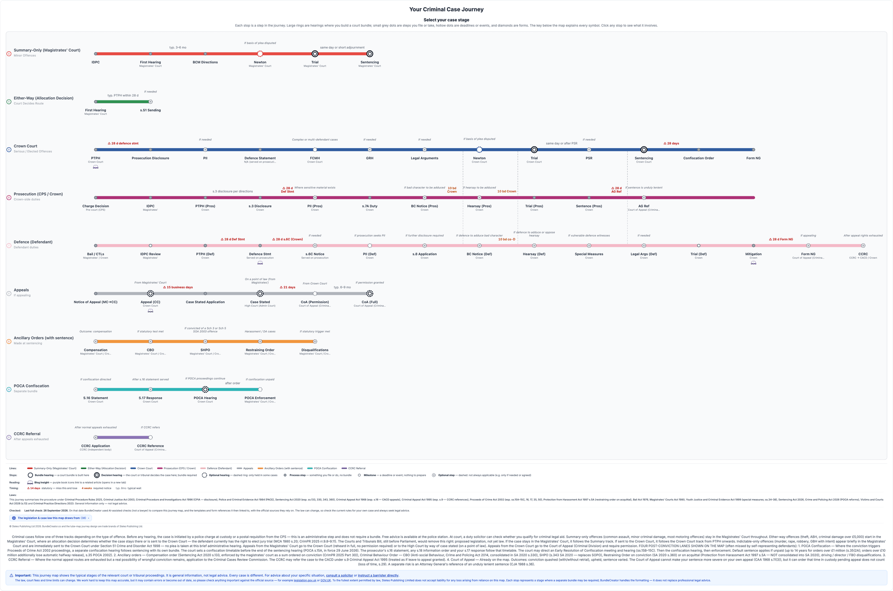](https://bundlecreator.co/criminal#journey-map)

- **Interactive map and guide:** [bundlecreator.co/criminal](https://bundlecreator.co/criminal)
- **Rules and legislation:** [Criminal Procedure Rules 2025](https://www.legislation.gov.uk/uksi/2025/909/contents)
- **Official starting points:** [Being charged with a crime](https://www.gov.uk/charged-crime) · [Criminal courts](https://www.gov.uk/courts)

### Wills, Trust & Probate

[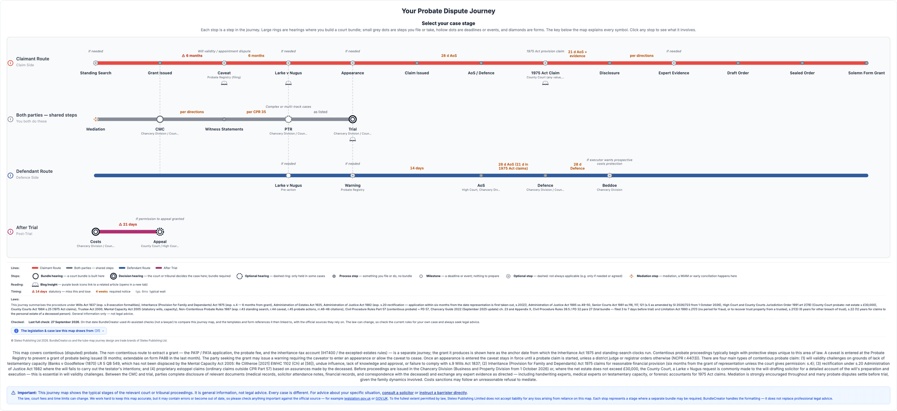](https://bundlecreator.co/wills-probate#journey-map)

- **Interactive map and guide:** [bundlecreator.co/wills-probate](https://bundlecreator.co/wills-probate)
- **Rules and legislation:** [Civil Procedure Rules, Part 57 (probate, inheritance, presumption of death and guardianship of missing persons)](https://www.justice.gov.uk/courts/procedure-rules/civil/rules/part57) · [Inheritance (Provision for Family and Dependants) Act 1975](https://www.legislation.gov.uk/ukpga/1975/63/contents)
- **Official starting points:** [Applying for probate](https://www.gov.uk/applying-for-probate)

### Intellectual Property

[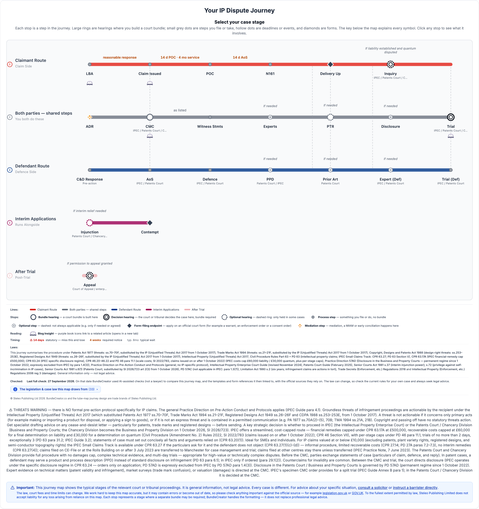](https://bundlecreator.co/intellectual-property#journey-map)

- **Interactive map and guide:** [bundlecreator.co/intellectual-property](https://bundlecreator.co/intellectual-property)
- **Rules and legislation:** [Civil Procedure Rules, Part 63 (intellectual property claims)](https://www.justice.gov.uk/courts/procedure-rules/civil/rules/part63)
- **Official starting points:** [Intellectual Property Enterprise Court](https://www.gov.uk/courts-tribunals/intellectual-property-enterprise-court)

### Bankruptcy

[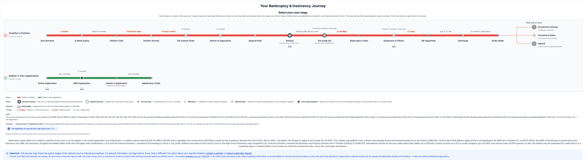](https://bundlecreator.co/bankruptcy#journey-map)

- **Interactive map and guide:** [bundlecreator.co/bankruptcy](https://bundlecreator.co/bankruptcy)
- **Rules and legislation:** [Insolvency Act 1986](https://www.legislation.gov.uk/ukpga/1986/45/contents) · [Insolvency (England and Wales) Rules 2016](https://www.legislation.gov.uk/uksi/2016/1024/contents)
- **Official starting points:** [Applying to become bankrupt](https://www.gov.uk/bankruptcy) · [Apply to bankrupt someone who owes you money](https://www.gov.uk/apply-to-bankrupt-someone) · [Options for dealing with your debts](https://www.gov.uk/options-for-dealing-with-your-debts)
- **Independent help:** [National Debtline](https://nationaldebtline.org/)

### Regulatory Law

[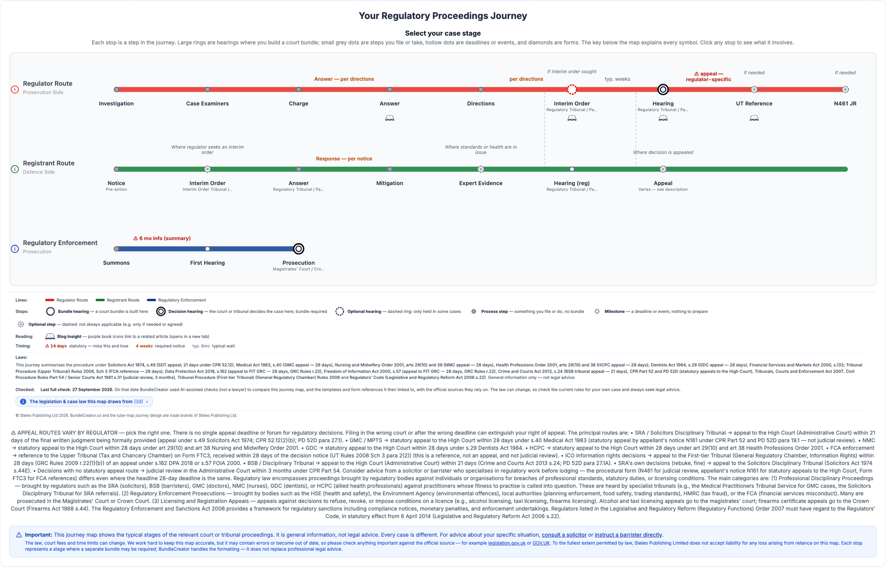](https://bundlecreator.co/regulatory-law#journey-map)

- **Interactive map and guide:** [bundlecreator.co/regulatory-law](https://bundlecreator.co/regulatory-law)
- **Rules:** Each regulator and disciplinary tribunal publishes its own procedure rules. Check the rules of the body hearing your case.

---

Links last checked: 11 November 2026. Each map carries its own "last full check" date.

© Steleo Publishing Ltd 2026. BundleCreator.co and the tube-map journey design are trade brands of Steleo Publishing Ltd. All rights reserved. The maps may not be copied or reused without permission.
